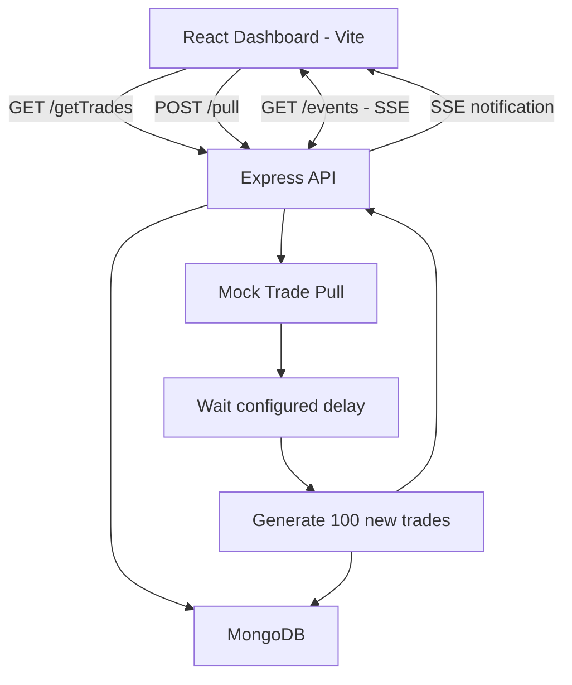

# ArhamTrade Dashboard Architecture

## Architecture Diagram

## Components

- **React + Vite:** Displays trades, statistics, search and filters.
- **Express API:** Handles trade retrieval and pull requests.
- **MongoDB:** Stores existing and newly generated trades.
- **Mock Pull:** Waits for the configured delay and inserts 100 new trades.
- **Server-Sent Events (SSE):** Notifies the frontend when pull status or trade data changes.

## Design Decisions

- Existing trades are available through the API while a pull is running.
- The pull delay is configurable using `PULL_DELAY_MS`.
- SSE allows the dashboard to update without manually refreshing the browser.
- MongoDB stores the trade records persistently.
